<div align="center">

<picture>
  <source media="(prefers-color-scheme: dark)" srcset="docs/assets/banner-dark.svg">
  
</picture>

<br>

<a href="COPYING"></a>


<a href="docs/privacy.md"></a>
<a href="#status"></a>

<h3>Your ledger stays a folder of Beancount text files.<br>Beanbook lets you work on it from your phone.</h3>

The real Beancount and Fava run on the device, so the figures you see are the ones<br>
`bean-check` and Fava give you on a desktop. No account, no sign-in, no server run by this project.

[**What it is**](#what-it-is) &nbsp;·&nbsp; [**See it**](#see-it) &nbsp;·&nbsp; [**What it does**](#what-it-does) &nbsp;·&nbsp; [**How a save works**](#how-a-save-is-written) &nbsp;·&nbsp; [**Editions**](#two-editions) &nbsp;·&nbsp; [**Privacy**](#privacy-and-network-use) &nbsp;·&nbsp; [**Build**](#build-and-test) &nbsp;·&nbsp; [**Docs**](#documentation)

</div>

## Status

> [!IMPORTANT]
> **Implemented, not released.** Both editions build and the quality gates pass, but the app has
> never been submitted to Google Play. There are no download links yet, here or anywhere else.
> When that changes, this section changes with it.

[docs/release-readiness.md](docs/release-readiness.md) tracks where the project stands against
the acceptance criteria in [SPEC.md](SPEC.md).

<picture>
  <source media="(prefers-color-scheme: dark)" srcset="docs/assets/rule-dark.svg">
  
</picture>

## What it is

Plain-text double-entry accounting on Android, for [Beancount](https://github.com/beancount/beancount)
ledgers. The app embeds CPython and runs the real Beancount and
[Fava](https://github.com/beancount/fava) on the device, so what you see on a phone is what
`bean-check` and Fava produce on a desktop. It can also act as a client for a Fava server you
host yourself.

Beanbook is an independent project. It is built on Beancount and Fava, and is not affiliated
with or endorsed by them.

Your books remain a folder of ordinary Beancount text files. There is no account to create, no
sign-in, and no server run by this project.

<div align="center">
<picture>
  <source media="(prefers-color-scheme: dark)" srcset="docs/assets/ledger-dark.svg">
  
</picture>
<sub>An invented ledger's transaction, and the order every save follows. The steps are explained <a href="#how-a-save-is-written">below</a>.</sub>
</div>

### Who it is for

People who already keep, or want to keep, books in Beancount and want to work on them from a
phone without converting to some app's private format. If you have never used plain-text
accounting, the [Beancount documentation](https://beancount.github.io/docs/) is the place to
start; this app assumes you know what a directive is.

It is not a general expense tracker, and it will not guess your categories for you.

### What makes it different

Most mobile bookkeeping apps import your data into a database you cannot read. This one edits
the files directly.

<table>
<tr>
<td width="50%" valign="top">

**The real engines, not a copy**<br>
Upstream Beancount and Fava run in-process. The app does not reimplement the parser or the
reports, so the numbers agree with your desktop.

</td>
<td width="50%" valign="top">

**Nothing of yours is thrown away**<br>
Includes, comments, metadata, whitespace outside an edited region, and directives the app
has no editor for all survive editing, export, and backup.

</td>
</tr>
<tr>
<td width="50%" valign="top">

**A form when it helps, the file when it does not**<br>
Guided entry covers common work. When a form is the wrong tool, you edit the file itself,
with highlighting, search, validation, and stale-write detection.

</td>
<td width="50%" valign="top">

**Getting your records out is free**<br>
Import, export, backup, and restore are free in both editions, like everything else. Getting
your records out is not a paid feature.

</td>
</tr>
</table>

<picture>
  <source media="(prefers-color-scheme: dark)" srcset="docs/assets/rule-dark.svg">
  
</picture>

## See it

<div align="center">

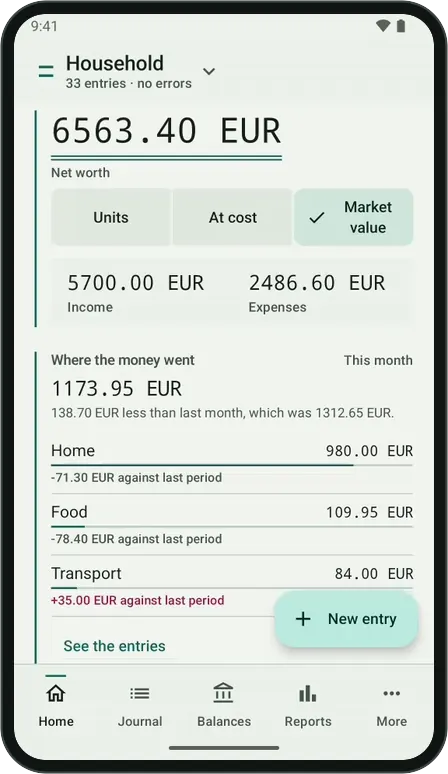
&nbsp;&nbsp;&nbsp;
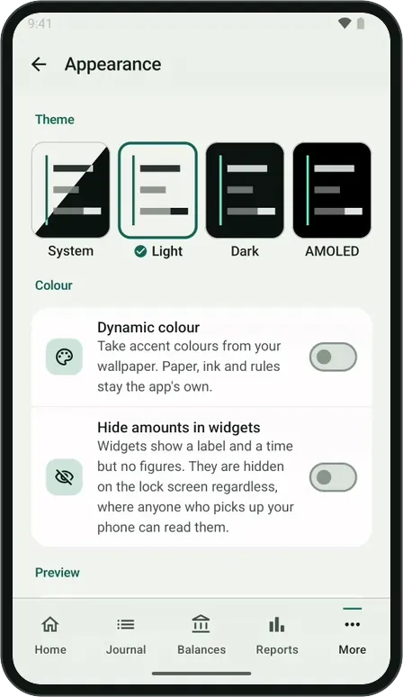

<sub>Recorded on an Android emulator with the Expert debug build. Left: Home, Journal, an entry, Balances and Reports. Right: switching the theme in More → Appearance.</sub>

<br><br>

<picture>
  <source media="(prefers-color-scheme: dark)" srcset="docs/assets/screenshots/phones-dark.webp">
  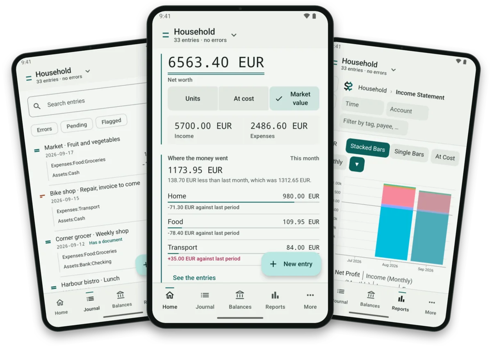
</picture>

</div>

### Light, Dark and AMOLED

<div align="center">
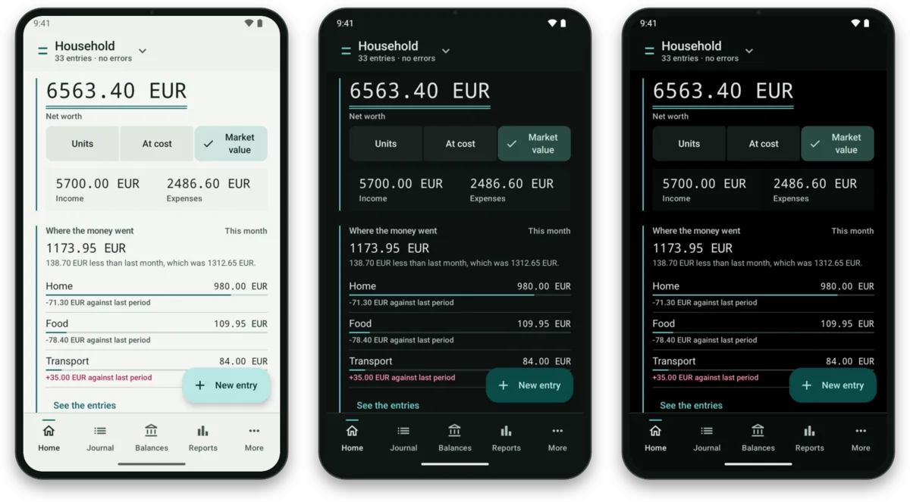

<sub>Paper, ink and one rule colour, in three themes. Dynamic colour can take the accent from your wallpaper instead; paper, ink and rules stay the app's own.</sub>
</div>

<details>
<summary><b>More screens</b>: an entry, the entry form, Balances, Documents, Plugins, widgets, 200% text</summary>
<br>

<table>
<tr>
<td align="center" width="33%">
<picture><source media="(prefers-color-scheme: dark)" srcset="docs/assets/screenshots/entry-dark.webp">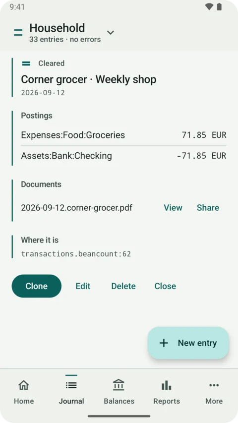</picture><br>
<sub><b>An entry</b>: its postings, its receipt, and the file and line it lives on.</sub>
</td>
<td align="center" width="33%">
<picture><source media="(prefers-color-scheme: dark)" srcset="docs/assets/screenshots/form4-dark.webp">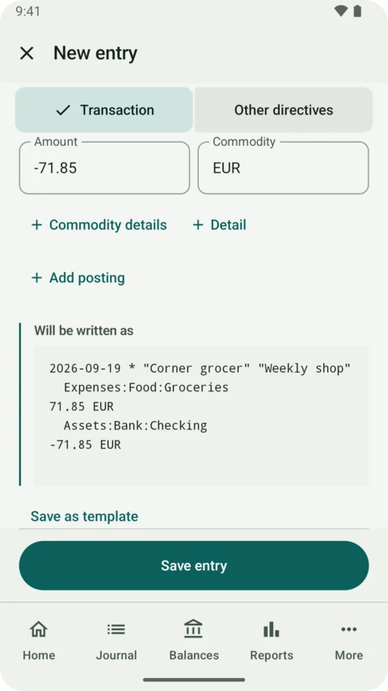</picture><br>
<sub><b>New entry</b>: the exact text is shown before anything is written.</sub>
</td>
<td align="center" width="33%">
<picture><source media="(prefers-color-scheme: dark)" srcset="docs/assets/screenshots/balances-dark.webp">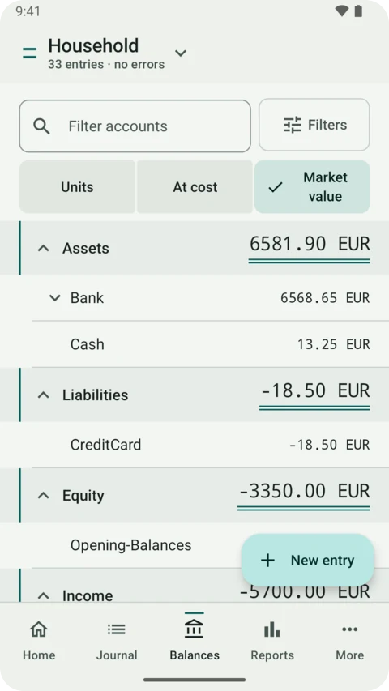</picture><br>
<sub><b>Balances</b>, in Units, At cost or Market value, as Fava does.</sub>
</td>
</tr>
<tr>
<td align="center">
<picture><source media="(prefers-color-scheme: dark)" srcset="docs/assets/screenshots/journal-dark.webp">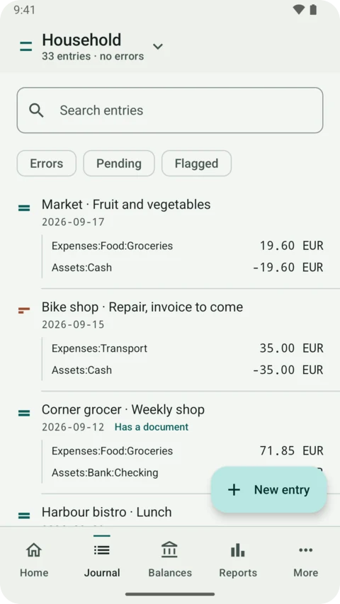</picture><br>
<sub><b>Journal</b>: search, and filters for errors, pending and flagged entries.</sub>
</td>
<td align="center">
<picture><source media="(prefers-color-scheme: dark)" srcset="docs/assets/screenshots/reports-dark.webp">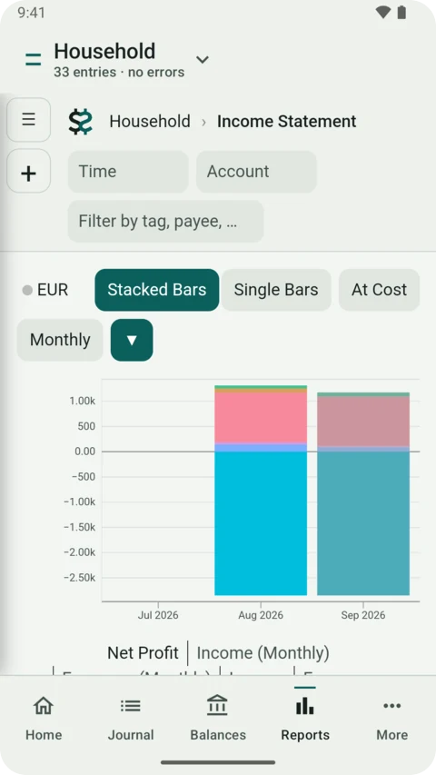</picture><br>
<sub><b>Reports</b>: Fava itself, dressed in the app's colours.</sub>
</td>
<td align="center">
<picture><source media="(prefers-color-scheme: dark)" srcset="docs/assets/screenshots/documents-dark.webp">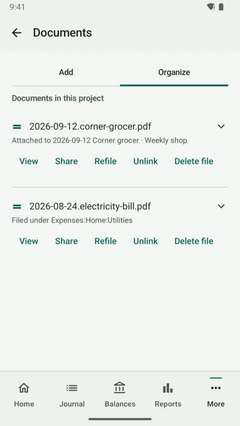</picture><br>
<sub><b>Documents</b>: receipts filed under an entry or an account.</sub>
</td>
</tr>
<tr>
<td align="center">
<picture><source media="(prefers-color-scheme: dark)" srcset="docs/assets/screenshots/more2-dark.webp">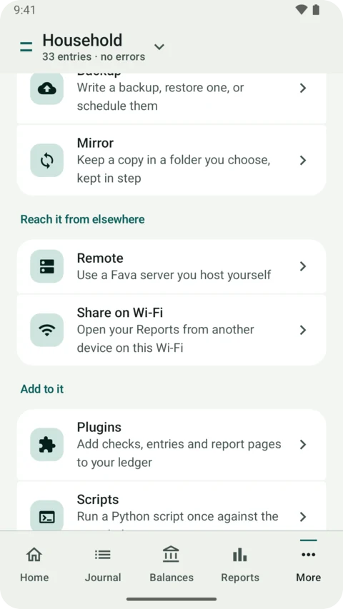</picture><br>
<sub><b>More</b>: backup, mirror, remote, sharing, plugins, scripts.</sub>
</td>
<td align="center">
<picture><source media="(prefers-color-scheme: dark)" srcset="docs/assets/screenshots/plugins-dark.webp">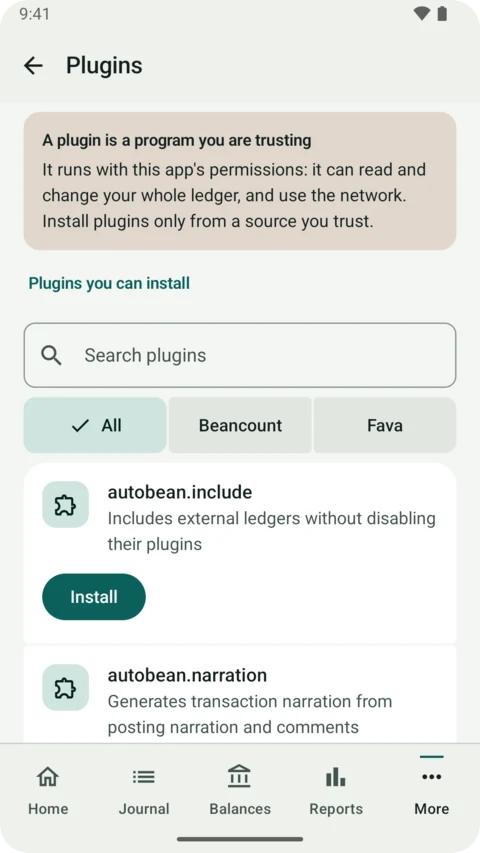</picture><br>
<sub><b>Plugins</b>, with the warning said plainly (Expert edition shown).</sub>
</td>
<td align="center">
<picture><source media="(prefers-color-scheme: dark)" srcset="docs/assets/screenshots/appearance-dark.webp">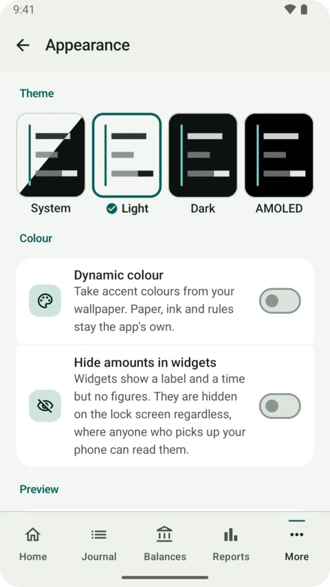</picture><br>
<sub><b>Appearance</b>: four themes, dynamic colour, hidden widget amounts.</sub>
</td>
</tr>
<tr>
<td align="center">
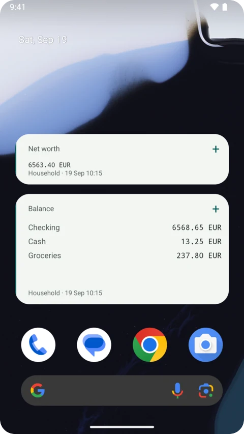<br>
<sub><b>Widgets</b> for net worth and chosen balances, each with a + to add an entry.</sub>
</td>
<td align="center">
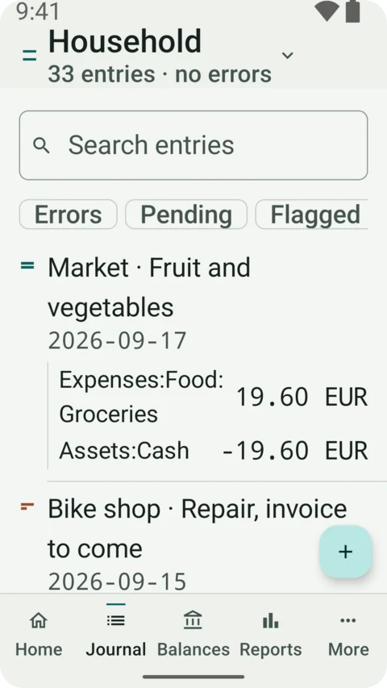<br>
<sub><b>200% text</b>: accounts wrap at the colon, figures stay whole.</sub>
</td>
<td align="center">
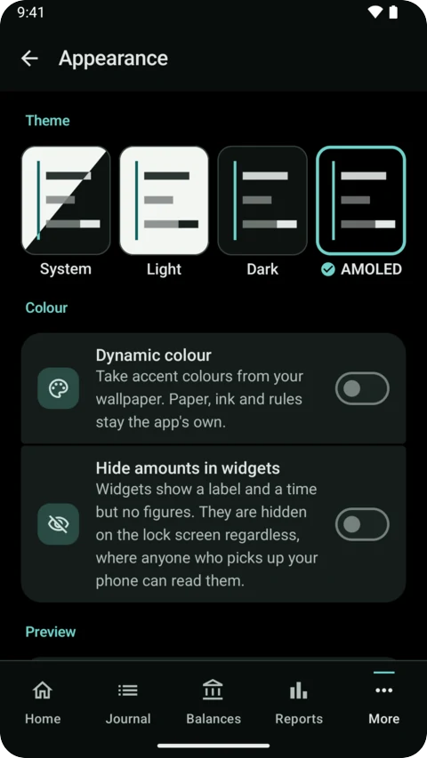<br>
<sub><b>AMOLED</b>: pure black for OLED screens.</sub>
</td>
</tr>
</table>

<sub>Captured on an Android emulator (API 36, 1080 × 1920, 420 dpi) from the Expert debug build, with the invented ledger in
[fixtures/site-screenshots/household](fixtures/site-screenshots/household). Every name and amount in them is made up.</sub>

</details>

<picture>
  <source media="(prefers-color-scheme: dark)" srcset="docs/assets/rule-dark.svg">
  
</picture>

## What it does

<table>
<tr>
<td width="50%" valign="top">

#### Entries and editing
Guided entry for common directives, plus editing, deleting, and duplicating existing entries.
The form shows the exact text it will write before you save. Every included file is directly
editable as text. Nothing is reported as saved until it has been written and read back
successfully, and a write that fails leaves the previous version of the file in place. The last
change can be undone.

</td>
<td width="50%" valign="top">

#### Reports
The full Fava surface: balance sheet, income statement, trial balance, holdings,
commodities, account and payee and tag views, charts, and BQL queries. Home, Balances and the
widgets show figures in Units, At cost or Market value, the way Fava's own switch does.

</td>
</tr>
<tr>
<td valign="top">

#### Documents
Capture receipts with the camera, crop them, assemble PDFs, and file them against entries.
Documents live inside the portable project tree.

</td>
<td valign="top">

#### Moving data
Import a folder tree or an archive, export a copy to a folder you choose, write backup archives,
and optionally mirror to a folder or schedule backups.

</td>
</tr>
<tr>
<td valign="top">

#### Remote mode
A deliberately narrow client for a Fava server you host. It gives you reports and quick-add
while the server is reachable. It does not keep an offline copy, edit existing remote entries,
or attempt two-way sync.

</td>
<td valign="top">

#### Share on Wi-Fi
Open your Reports from another device on the same private network, in a browser. Off until you
turn it on, behind a username and password you set, with a notification for as long as it runs.

</td>
</tr>
<tr>
<td valign="top">

#### Plugins and scripts
Beancount plugins and Fava extensions load with your ledger, and you can run your own Python
scripts against it. A safe mode loads the ledger with no plugins.
[docs/plugin-compatibility.md](docs/plugin-compatibility.md) says which were tested and how.

</td>
<td valign="top">

#### Widgets and appearance
Home-screen widgets for net worth and balances. Light, Dark and AMOLED themes, optional dynamic
colour, and an accessibility test that checks labels and layout at normal size and at 200% text.

</td>
</tr>
</table>

## How a save is written

Every change, from the entry form, the file editor or a delete, takes the same path. Success is
reported only at the end, after Beancount has read the ledger back.

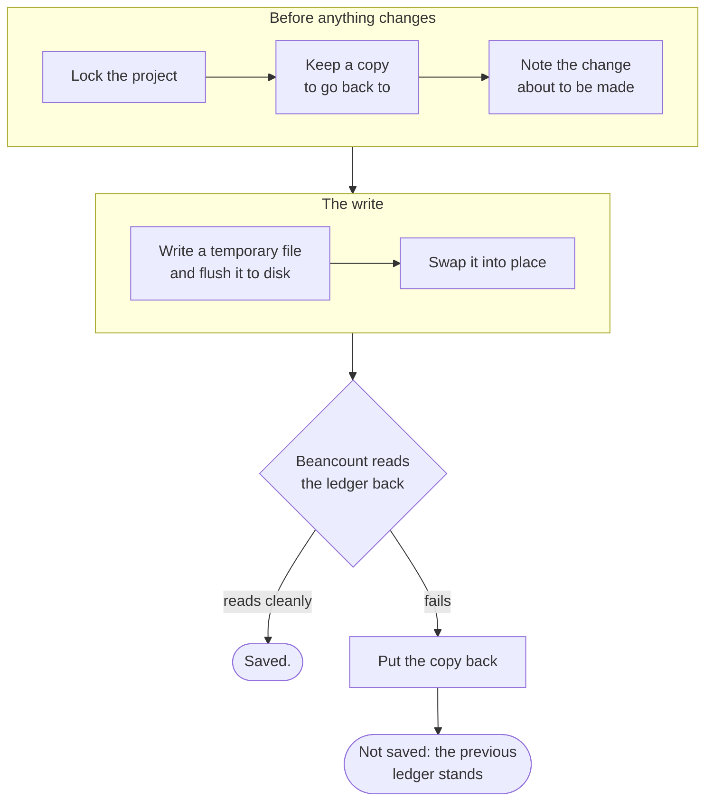

<details>
<summary><b>The rules every change keeps</b> (for contributors)</summary>
<br>

These are release-blocking. [CLAUDE.md](CLAUDE.md) and [CONTRIBUTING.md](CONTRIBUTING.md) hold
the full text.

| # | Rule |
|---|---|
| 1 | `Decimal` only for money. Never binary floating point. |
| 2 | No success message before a durable write **and** a successful re-parse. |
| 3 | A failed operation leaves the previous valid project recoverable. |
| 4 | Unknown directives, metadata, comments, and whitespace are never silently discarded. |
| 5 | `include` directives and document links stay valid across import, export and mirror. |
| 6 | A retried write never creates a duplicate entry. |
| 7 | Destructive actions name their scope and are confirmable or undoable. |
| 8 | Undo is backed by durable snapshots, not UI state. |

</details>

<picture>
  <source media="(prefers-color-scheme: dark)" srcset="docs/assets/rule-dark.svg">
  
</picture>

## Two editions

Play and Expert read the same projects, are both entirely free, and share every feature except
three points that Google Play policy decides. They also update differently:

| | Play | Expert |
|---|:---:|:---:|
| Local Beancount and Fava | Included | Included |
| User plugins and extensions | Pure Python only | Pure Python and compatible native packages |
| Android bridge in user Python | Withheld | Available |
| Optional package downloads | None | User-confirmed |
| App updates | Google Play | Signed package, confirmed by you |

<table>
<tr>
<td width="50%" valign="top">

**Choose Play** if you want store-managed updates and your own plugins do not need native
packages or Android APIs.

</td>
<td width="50%" valign="top">

**Choose Expert** if your plugins need compatible native packages or the Android bridge, you
want packages fetched on demand, and you are comfortable installing a signed build directly.

</td>
</tr>
</table>

The Play restrictions are compliance with Google Play's rules about shipping executable code,
not a security boundary: plugins you supply run as ordinary Python in both editions, with your
ledger in reach. The Play edition tells you the Expert edition exists and what it adds.
[docs/editions.md](docs/editions.md) explains which to pick.

## Privacy and network use

No account, no sign-in, no telemetry, no analytics, no crash reporting, and no ads, in either
edition. Local mode makes no network requests at all.

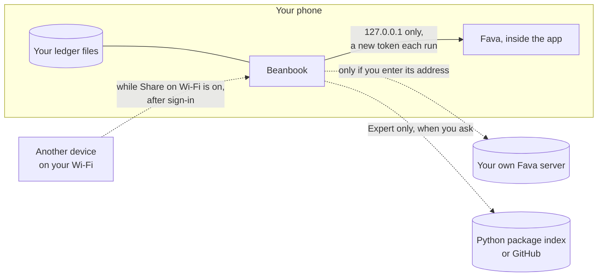

The app reaches out to the network only in cases you start:

- **Your own Fava server**, if you enter its address in remote mode.
- **A plugin or an optional Python package**, in the Expert edition only, when you ask for one.
  The Play edition never downloads code from anywhere.

**Share on Wi-Fi** is the one way in. It is off until you turn it on, listens only on the phone's
private network address, shows nothing until someone signs in with the username and password you
set, locks out repeated wrong passwords, and keeps a notification up for as long as it runs. The
connection is plain `http://`, so use it only on a network you trust.

If you type an `https://` address, certificate errors are fatal and cannot be overridden in
any build. If you type an `http://` address, that traffic is unencrypted and can be read or
modified on the network path, including any password you set. The app says so on screen before
connecting. Cleartext is never inferred and never used as a fallback after a failed HTTPS
connection; it happens only when you type `http://` yourself.

[docs/privacy.md](docs/privacy.md) has the full position, and
[docs/threat-model.md](docs/threat-model.md) has the reasoning behind it.

<picture>
  <source media="(prefers-color-scheme: dark)" srcset="docs/assets/rule-dark.svg">
  
</picture>

## Requirements

- Android 10 (API 29) or later. Android 9 does not work: the embedded Python runtime is killed
  by seccomp before the engine starts.
- `arm64-v8a` or `x86_64`. There is no 32-bit build.
- Roughly 48.5 MB to download for a single architecture, or 59.3 MB for the universal package.
  Optional Expert packages add to that, and take noticeably more room unpacked than they do
  to download.

Ships CPython 3.13, Beancount 3.2.3, Fava 1.30.15, beanquery 0.2.0, and beangulp 0.2.0.

## Getting started

Create a ledger or import an existing project, then work on it. The short version:

1. Open Projects and create a new ledger, or import a folder tree or archive.
2. Import the whole tree rather than a single `.beancount` file, so includes and document
   links stay valid.
3. Fix any parse errors in the raw editor, which reports file, line, and column.
4. Set up an export folder, a backup, or mirroring before you rely on the app.

[docs/getting-started.md](docs/getting-started.md) covers each step, where your files actually
live, and what to do when something goes wrong.

<details>
<summary><b>Where your files live</b></summary>
<br>

Projects live in app-private storage, which is canonical. That is not an aesthetic choice:
Python and Fava need real POSIX paths, and Android's folder picker hands out content URIs.
Modern file managers cannot browse app-private storage, so the app provides explicit routes
out — an in-app editor for every included file, export to a folder you pick, backup archives,
and optional mirroring. Caches, logs and credentials are kept outside the
portable project tree, so an exported copy contains your ledger and nothing else.

</details>

## Limitations worth knowing before you rely on it

No Git integration. No offline cache in remote mode. No 32-bit build. No OCR yet. No vetted
plugin catalogue: in the Play edition you supply plugin files yourself. English UI only. The app
was designed and measured around ledgers of roughly 25,000 transactions in about 10 MB; larger
ones work, but the first load after a change costs real time.

[docs/known-limitations.md](docs/known-limitations.md) is the full list, written for someone
deciding whether to depend on this.

## Free, with donations welcome

Every feature is free in both editions: no trial, no paid tiers, no keys, no ads. If Beanbook
is useful to you, the project will accept donations on Ko-fi -- the page is not open yet. The
Expert edition mentions it once, after a week of use; the Play edition does not link to it,
because Google Play's payment rules do not allow that. [docs/support-model.md](docs/support-model.md)
explains the decision.

<picture>
  <source media="(prefers-color-scheme: dark)" srcset="docs/assets/rule-dark.svg">
  
</picture>

## Build and test

The build needs a little more than a checkout because of the embedded Python runtime: a JDK and
the Android SDK, a host CPython 3.13 for Chaquopy's pip, and the cross-built `beancount` and
`watchfiles` wheels. [CONTRIBUTING.md](CONTRIBUTING.md) walks through it.

```bash
. spikes/env.sh                                       # JDK, SDK and Gradle paths on the build machine
tools/build-wheels.sh --out ~/tools/wheels            # pinned sdists, pinned build backends

./gradlew :core-domain:test :core-data:test :core-engine:test :app:testPlayDebugUnitTest
./gradlew :app:assemblePlayDebug :app:assembleExpertDebug
./gradlew :app:verifyPlayFlavorBoundaries             # the Play edition's build gate
./gradlew detekt                                      # gates CI; run it before pushing
```

<details>
<summary><b>More checks</b>: release builds, lint, Python tests, the golden corpus, instrumentation</summary>
<br>

```bash
./gradlew :app:assemblePlayRelease :app:assembleExpertRelease
./gradlew :app:lintPlayDebug :app:lintExpertDebug

# Python layer: the interpreter must have beancount importable
~/tools/bc-desktop/bin/python3 -m unittest discover -s engine-local/src/test/python

# Golden corpus: generate fixtures, then record or verify against upstream Beancount
~/tools/bc-desktop/bin/python3 tools/corpus/generate.py --out corpus
~/tools/bc-desktop/bin/python3 tools/corpus/differential.py verify

# Instrumentation, on a device or emulator
./gradlew :app:connectedExpertDebugAndroidTest
```

A change is done when it builds in both editions, debug and release; unit and instrumentation
tests pass on API 29 and 36; the golden corpus round-trips byte-clean; and new screens pass the
accessibility checks. [CLAUDE.md](CLAUDE.md) lists every command and what each one needs.

</details>

## Documentation

For users:

| Document | Contents |
|---|---|
| [docs/getting-started.md](docs/getting-started.md) | First project, importing an existing ledger, moving data, troubleshooting |
| [docs/editions.md](docs/editions.md) | Play against Expert, and supporting the project |
| [docs/privacy.md](docs/privacy.md) | What stays on the device and when the network is used |
| [docs/known-limitations.md](docs/known-limitations.md) | What the app cannot do, and why |
| [docs/on-demand-packages.md](docs/on-demand-packages.md) | Fetching extra Python packages, Expert only |
| [docs/plugin-compatibility.md](docs/plugin-compatibility.md) | Which plugins and extensions work, and how that was tested |

For developers:

| Document | Contents |
|---|---|
| [CONTRIBUTING.md](CONTRIBUTING.md) | Building, testing, and the constraints a change must preserve |
| [docs/architecture.md](docs/architecture.md) | Components, trust boundaries, process model, dependency direction |
| [docs/storage-and-backup.md](docs/storage-and-backup.md) | Workspace layout, atomic writes, SAF import and export, archives |
| [docs/threat-model.md](docs/threat-model.md) | Assets, adversaries, mitigations, accepted risk |
| [docs/distribution.md](docs/distribution.md) | Edition matrix, update channels, the Play payment rules |
| [docs/design-direction.md](docs/design-direction.md) | The visual system: paper, ink, rules and folios |
| [SPEC.md](SPEC.md) | Product scope, non-goals, acceptance criteria |

## Contributing

Bug reports and patches are welcome. [CONTRIBUTING.md](CONTRIBUTING.md) covers the build,
which needs a little more than a checkout because of the embedded Python runtime, and the
boundaries a change has to keep: the data invariants, the edition split, and the licence.
Security reports go through [SECURITY.md](SECURITY.md).

## Licence

GPL-2.0-only.

Beancount, beanquery, and beangulp are GPL-2.0-*only*, explicitly not "or later". GPLv3 code
cannot be used here. The full text is in [COPYING](COPYING), and the copyright holders are
listed in [AUTHORS](AUTHORS).

Neither edition links any proprietary library for payments: nothing is sold (B81). There is
no additional licence permission: Beanbook is GPL-2.0-only, with nothing added.

Beancount and Fava are independent projects. This app is built on their work and is not
affiliated with or endorsed by them.

<br>

<div align="center">
<picture>
  <source media="(prefers-color-scheme: dark)" srcset="docs/assets/rule-dark.svg">
  
</picture>

<sub>Paper, ink, and one rule. Every figure in these images comes from an invented ledger.</sub>
</div>
